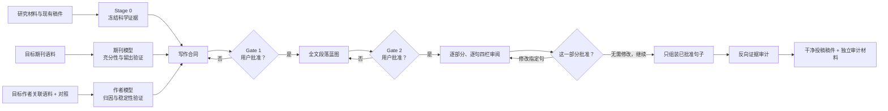

<p align="center">
  
</p>

# Like a Paper

> 不是让 AI “写得像论文”，而是让它先证明自己理解了**目标期刊如何组织论证**、**目标作者关联语料中哪些决策真正稳定**，再依据已经冻结的研究证据，一部分一部分地完成论文。

`like-a-paper` 是一个面向 Codex / Agent 工作流的循证论文写作 Skill。它把通常被一句“请按 GRL 风格润色”掩盖掉的工作拆开：冻结科学事实、筛选语料、验证蒸馏是否可靠、建立写作合同、设计段落逻辑、逐句对照证据、人工审批，最后再组装全文。

它不是“降 AI 率”工具，也不承诺绕过检测、模仿某位在世作者的独特文风，或保证论文录用。它追求的是另一件更重要的事：让论文的**深度、语气和结构都能解释其来源**，同时让每个科学主张回到正确的图、表、统计结果、方法记录或文献证据。

## 一句话看懂

一般的提示词是：

```text
读几篇论文，模仿它们的风格，然后帮我改全文。
```

`like-a-paper` 把它改造成：

```text
先冻结我的研究事实；再分别检验目标期刊语料和目标作者关联语料是否足够；
只有通过留出验证与稳定性检查的写作决策，才允许进入写作合同；
合同和段落蓝图经我批准后，逐句给出英文、中文、对应依据和修改说明；
最后只用我批准过的句子组装论文，并反向审计。
```

## 为什么需要它

论文“写得深”并不等于句子更长、术语更多或语气更肯定。真正的深度通常来自：

- 先回答最重要的科学问题，再安排结果顺序；
- 把定量结果、边界条件、异常与不确定性写在正确位置；
- 区分本研究观察、外部事实、机制解释、替代解释和推测；
- 让引言提出的问题、结果给出的证据和讨论允许的结论彼此闭合；
- 在目标期刊可接受的篇幅与节奏内，把主张强度控制在证据上限以内；
- 与前人工作比较时，明确仪器、样本、时间、空间、高度或方法是否真的可比。

这正是本 Skill 所蒸馏的对象。它学习的是**高层写作决策**，不是可复制的原句。

## 与公开论文写作 Skills 有什么不同

先说明一个边界：我们不会声称“只有本项目做证据控制”或“首次研究作者写作习惯”。公开项目中已经有不少扎实工作。例如：

- [`msimchowitz/writing-skills`](https://github.com/msimchowitz/writing-skills/blob/main/for-agents/paper-writing/SKILL.md) 强调证据保真、claim–evidence map、论文计划与逐行修改；
- [`Jingyang-Zhu/personal-academic-writing-skill`](https://github.com/Jingyang-Zhu/personal-academic-writing-skill) 从个人论文与目标 venue 中提炼作者/场合画像；
- [`felixschrimpff/academic-writing-skill`](https://github.com/felixschrimpff/academic-writing-skill) 用大规模开放论文语料估计学术语域指标，并进行留出评估；
- [`CarrieX6/Academic-paper-writing-skill`](https://github.com/CarrieX6/Academic-paper-writing-skill) 关注 venue-aware 结构、claim–evidence 控制、作者声音恢复与受保护内容。

因此，本项目的区别不在某一个孤立功能，而在这些约束是否组成了一个**每次项目都必须走完的闭环**。下表比较的是公开文档所呈现的常见重心，不表示每个项目都缺少左栏之外的能力：

| 维度 | 常见公开方案的可见重点 | `like-a-paper` 的工作重点 |
|---|---|---|
| 风格来源 | 通用学术写作规则、大语料语域指标、示例论文或静态画像 | 针对当前项目重新建立目标期刊模型、作者关联模型，或二者的独立模型 |
| 语料是否够用 | 有时由用户提供数量或 Agent 主观判断 | 先过硬门槛；数量、相关性、章节覆盖、团队/年代多样性、留出验证、反例与饱和度同时检查 |
| 作者归因 | 从作者论文提炼偏好 | 不把多作者论文直接归因给一个人；要求作者角色、匹配对照、跨期刊/团队/时期变化和最大簇移除测试 |
| 期刊与作者冲突 | 合并成一个风格画像 | 两个模型先独立通过；冲突时科学证据与期刊硬要求优先，失败模型不得“借道”进入正文 |
| 科学内容 | 写作时同时理解或补全 | 先冻结事件样本、数据版本、方法、图表、数值和统计结论；事实未定稿时不进入风格改写 |
| 人工控制 | 最终审稿或按轮次反馈 | Gate 1 批准写作合同，Gate 2 批准段落蓝图；两次都未通过前不写具体正文句子 |
| 逐句呈现 | 直接给改稿、行编辑或技术台账 | 用户默认只看“英文—中文—对应依据—修改说明”；复杂 ID、风险和状态留在内部审计层 |
| 证据映射 | 重点多为文献引用或 claim–evidence | 结果句回到本研究图表/统计，方法句回到方法/代码，过渡句回到蓝图；不强迫每句伪造一条文献依据 |
| 最终组稿 | 改完整体后交付 | 只组装明确批准的句子，随后从最终稿反查证据、数字、语气和段落衔接 |
| 失败处理 | 继续生成并提示风险 | `FAIL` 仍是 `FAIL`；只允许补语料、缩小范围、切换到已通过模式，或明确放弃语料驱动写作 |

这是一项基于上述公开仓库当前文档的抽样比较，不是对整个 GitHub 生态的穷尽性排名，也不是“唯一/最好”的宣称。

## 三种模式

### 1. 期刊模式 `journal`

回答的问题是：**这一类研究在目标期刊中通常怎样建立问题、安排证据、控制篇幅并限定主张？**

适合已经确定投稿期刊，但不需要研究某位作者的项目。

### 2. 作者语料模式 `author`

回答的问题是：**跨期刊、跨团队、跨时期后，目标作者关联论文中还有哪些论证决策保持稳定？**

输出被谨慎称为“作者关联语料画像”，而不是“作者本人文风”。多作者论文的具体措辞可能来自共同作者、课题组传统、编辑或审稿过程，不能简单归到一个人名下。

### 3. 混合模式 `hybrid`

期刊模型与作者关联模型先独立蒸馏、独立验证，再解决冲突。只有两边都通过，混合模式才通过；一个模型合格不能掩盖另一个模型失败。

## 整体工作流



流程故意把“理解语料”和“开始写作”隔开。语料没通过，不能因为用户着急就冒充已经蒸馏成功；Gate 1 或 Gate 2 没批准，也不能偷偷用“示范句”提前写正文。

## 语料达到什么标准才允许写

下面是保守的默认下限。达到数量只是必要条件，仍须通过章节覆盖、反例、留出验证、饱和度和提取质量检查。

### 期刊模型默认硬门槛

- 至少 8 篇目标期刊、匹配文章类型的可用全文；
- 至少 5 篇在主题、方法、数据尺度或科学任务上直接相关；
- 当前有效的期刊作者指南或等价正式要求；
- 至少 3 个相互独立的作者团队；
- 至少 2 个发表时期或年份带；
- 至少 2 篇预先保留、不参与初始规则生成的验证论文；
- 每个要由模型管理的论文部分至少 4 个可用实例；
- 高置信规则通过留出集、反例与最终批次饱和度检查；
- 请求部分不存在关键全文提取缺口。

### 作者关联模型默认硬门槛

- 至少 10 篇目标作者关联的可用全文；
- 至少 6 篇作者主导论文，包括独著、一作、通讯、共同一作/通讯或有明确初稿贡献的论文；
- 至少 2 本期刊；
- 至少 2 种共同作者或课题组配置；
- 至少 2 个独立时期、主题/方法或其它可辨别情境；
- 至少 4 篇匹配对照，覆盖至少 2 个相关情境；
- 至少 60% 的计入论文有可判断的作者角色或贡献信息；
- 至少 2 篇保留验证论文；
- 每个要管理的部分至少 4 个可用实例；
- 移除最大的期刊、共同作者或实验室簇后，所谓稳定规则仍成立；
- 高置信规则通过留出验证、反例、饱和度和提取完整性检查。

### 只允许三种正式判定

- `PASS`：当前模式可以进入写作合同，但仍不能直接写正文；
- `SECTION_LIMITED`：全局条件通过，但只有明确列出的部分有足够实例；
- `FAIL`：一个或多个全局硬条件未通过，不得声称已经得到可用于生成的目标模型。

用户可以接受某个降级路线，但不能用一句“我接受风险”把 `FAIL` 改成 `PASS`。这项限制不是为难用户，而是防止 Agent 对少量文献过拟合后，以“目标期刊/目标作者风格”的名义输出并不存在的规律。

## 用户看到的内容，与内部保存的内容

为了兼顾可读性和可审计性，Skill 使用双层界面。

### 用户默认只看四项

每一部分开始前，Agent 先说明：

- 这一部分具体要讲什么；
- 它在全文中承担什么功能；
- 主要使用哪些本研究证据和外部文献；
- 它怎样承接前一部分并引向下一部分。

随后，每句话只显示：

1. **English**
2. **中文**
3. **对应依据**
4. **修改说明**

示意如下：

> **English**  
> The median response peaked 6 h after the event onset.
>
> **中文**  
> 中位响应在事件开始后 6 小时达到峰值。
>
> **对应依据**  
> 本研究 Figure 4b；冻结分析表 `timing_summary.csv` 中的 median 行。这里不需要为了“像论文”而附加一条外部文献句。
>
> **修改说明**  
> 把原稿中模糊的 “a delayed peak” 改为已冻结的 6 h 定量结果，并把结论限定在当前批准样本内，不解释为因果延迟机制。

带有机制解释的句子则可能同时需要本研究结果和外部文献。下面仍是结构示意，不代表真实引文：

> **English**  
> The delayed response is consistent with storm-driven circulation changes redistributing energy in the lower thermosphere.
>
> **中文**  
> 这种延迟响应与风暴驱动的环流变化在低热层重新分配能量的解释一致。
>
> **对应依据**  
> 本研究：冻结的滞后分析与 Figure 4，直接支撑“存在延迟”，但不能识别因果机制。  
> 外部文献：`[Author et al., Year]`，背景支撑；显示不超过必要长度的原文短摘录或忠实来源说明，并给出 DOI、章节/段落或页码定位。
>
> **修改说明**  
> 使用 “is consistent with” 而不是因果动词；因为当前分析只观察到时间关系，外部文献也只能提供机制背景。

如果是外部事实或文献比较，“对应依据”才显示短原文摘录或忠实来源说明、引用、精确位置以及它属于直接、部分、类比、背景还是对照支撑。短摘录用于核验，不用于换词仿写。

每一部分末尾，Agent 只问：

```text
这一部分是否需要修改？如果不需要，请回复“无需修改，继续”。
```

如果用户要求修改，只重写受影响的句子以及确实被其逻辑牵连的衔接句。用户不需要管理内部编号。

### 内部仍保存完整审计层

机器台账继续记录：稳定句子 ID、段落功能、主张类型、证据类型与位置、支撑关系、主张上限、前后逻辑、风险标记、版本和审批时间。需要时可要求 Agent “显示审计视图”。

这意味着界面可以简单，但安全机制不会随之消失。

## 安装

### Windows PowerShell

```powershell
git clone https://github.com/siyunhao2025-beep/like_a_paper.git "$env:USERPROFILE\.codex\skills\like-a-paper"
```

### macOS / Linux

```bash
git clone https://github.com/siyunhao2025-beep/like_a_paper.git ~/.codex/skills/like-a-paper
```

安装后重新加载 Skills 列表或重新打开 Codex 任务。Skill 目录名建议保持为 `like-a-paper`。

## 第一句应该怎样对 Agent 说

### 最推荐：期刊模式

复制下面这段，替换路径和期刊名即可：

```text
使用 $like-a-paper，以期刊模式处理我的论文。
目标期刊：GRL。
文章类型：Research Letter。
稿件、LaTeX 或 PDF 路径：XXXX。
最终数据、图表、统计输出与代码路径：XXXX。
目标期刊强相关论文语料路径：XXXX。

论文中的样本、数据版本、处理方法、图表、数值结果和统计结论已经定稿。
请先审查并冻结科学证据，再检验语料充分性。
在 Gate 1 写作合同和 Gate 2 全文段落蓝图分别得到我明确批准前，不要写正文句子。
```

### 混合模式：目标期刊 + 目标作者

```text
使用 $like-a-paper，以混合模式处理我的论文。
目标期刊：XXXX。
文章类型：XXXX。
目标作者：XXXX。
稿件与全部确定性研究材料路径：XXXX。
目标期刊语料路径：XXXX。
目标作者跨期刊论文路径：XXXX。
匹配对照论文路径：XXXX。

请分别建立期刊模型和作者关联模型，不要把二者混在一起判定。
先冻结证据并完成两个模型的充分性验证；没有通过的模型不得参与写作。
在 Gate 1 与 Gate 2 分别获得我的明确批准前，不要写正文句子。
```

### 只有一篇原稿、还没整理语料

```text
使用 $like-a-paper。先检查我的原稿和研究材料，告诉我还缺哪些目标期刊语料、作者角色信息、对照论文或冻结证据。现在不要开始改写，也不要把语料不足描述成已经通过。
```

## Agent 的第一次回复应该包含什么

一次合格的开场不应立即给你“润色后的摘要”，而应：

1. 确认当前使用 `journal`、`author` 还是 `hybrid`；
2. 盘点路径中已经存在的稿件、图表、结果、代码、期刊指南和论文语料；
3. 只询问无法从文件中发现、且会改变流程的缺失信息；
4. 明确说明在 Gate 1 前不会写正文；
5. 从科学证据审查与冻结开始；
6. 给出下一次需要用户批准的准确对象，而不是一次抛出所有内部表格。

## 从第一句话到完整论文：用户实际会经历什么

### Stage 0：冻结确定性研究内容

Agent 核对：

- 科学问题和中心贡献；
- 事件/样本定义、纳入与排除规则；
- 数据产品、版本、时间范围、空间/高度范围；
- 方法、参数、代码与运行配置；
- 图、表、图注和底层数值；
- 统计量、分母、单位、不确定性和显著性定义；
- 已知限制与不能得出的结论；
- 原稿各处是否存在数字或语气冲突。

如果关键冲突可能改变结论，流程停止。仅仅说“图已经画好了”不等于科学证据已经冻结。

### Stage 1：登记并筛选语料

每篇论文都记录：为何纳入、属于直接相关还是邻近相关、能支持哪个论文部分、全文是否可读、作者角色、团队/时期/期刊簇、是发现集还是验证集，以及它**不能**支持什么。

### 语料充分性闸门

Agent 先用发现集提出候选规律，再用预留论文测试。若验证集改变了主要规律，就不能把同一批论文重新包装成“独立验证”；必须修正规则并保留新的未见样本，或补充语料。

### Stage 2：形成写作合同

写作合同不是正文，而是一组可执行规则，至少包括：

- 中心科学问题与主张上限；
- 目标期刊的篇幅、结构和证据节奏；
- 各部分采用的修辞动作顺序；
- 数字、文献、限制和机制解释出现的位置；
- 允许使用的稳定规律与不能使用的混杂规律；
- 禁止模仿的独特短语；
- 全文结构和仍未解决的问题。

此时必须停在 Gate 1。用户可以回复：

```text
批准 Gate 1 写作合同。确认以上述中心科学问题和主张上限建立全文段落蓝图。不要开始写具体句子。
```

### Stage 3：建立全文段落蓝图

蓝图逐段说明：这段回答什么、承担什么功能、使用什么本研究证据与外部文献、主张上限在哪里、怎样承上启下、哪些结论不能写。

此时必须停在 Gate 2。用户可以回复：

```text
批准 Gate 2 全文段落蓝图。按顺序从 Title、Key Points、Plain Language Summary 和 Abstract 开始逐句审阅，不要开始 Introduction。
```

### Stage 4：逐部分、逐句审阅

Agent 先介绍当前部分，再按四项展示每句话。你可以直接说：

```text
第三句的因果语气过强，把“demonstrates”改为“suggests”；对应文献只能标成类比支撑。其余句子不变。
```

也可以说：

```text
无需修改，继续。
```

后一句表示批准刚刚明确展示的整个部分。Agent 随后进入下一部分，直到所有内容完成。

### Stage 5：组装干净稿件

只有状态为 `approved` 的准确版本才能进入最终论文。中文翻译、来源短摘录、内部 ID、风险标记和审批元数据保留在独立审计材料里，不进入投稿稿件。

### Stage 6：反向审计

最终稿逐句回查：

- 数字、单位、正负号、分母与冻结结果一致；
- 图表、图注和正文一致；
- 引文真的支持相邻命题，而不是只“看起来相关”；
- 不同仪器、样本、时间、空间或高度条件的比较没有被抹平；
- 观察、解释、推测、限制没有混写；
- 因果动词没有超过研究设计；
- 摘要、Key Points 和结论没有引入正文不存在的新主张；
- 组稿时没有偷偷改变已批准句子；
- 来源措辞重合经过人工复核。

## 语料不够时会怎样

Skill 不会“凑够几条规律”后继续写。它会给出主要阻断项，并把尚未有资格执行的后续测试标成 `NOT ESTABLISHED`，而不是制造一串看似独立的失败。

合法路线只有：

1. 补充指定类型的全文、作者角色信息或匹配对照；
2. 把任务缩小到已经达到章节覆盖的部分；
3. 从混合模式切换到已经独立通过的期刊或作者模式，并重新批准写作合同；
4. 明确放弃“目标语料驱动风格”，改用普通的循证写作；
5. 对极小众领域，使用明确标注的 `FIELD_CONVENTION_PROFILE_ONLY`，但不得冒充目标期刊或目标作者模型已经通过。

诊断标签如 `JOURNAL_ONLY_ELIGIBLE`、`EXPLORATORY_AUTHOR_PROFILE_ONLY` 或 `FORMAL_REQUIREMENTS_ONLY` 只是下一步路线，不是第四种通过判定。

## 项目文件与可恢复状态

长项目可以先创建工作目录：

```bash
python scripts/init_workspace.py D:/my-paper-work --mode journal
```

目录结构如下：

```text
00_intake/              研究材料、证据清单、未决问题
01_corpus/journal/      目标期刊语料
01_corpus/author/       目标作者关联语料
01_corpus/controls/     匹配对照论文
01_corpus/text/         合法取得并提取的本地文本
02_distillation/        语料登记、充分性判定、蒸馏报告
03_contract/            写作合同与审批记录
04_blueprint/           全文段落蓝图
05_sentence_ledger/     机器台账与用户审阅稿
06_manuscript/          干净论文
07_audit/               最终反向审计
project.json            当前模式、阶段与恢复状态
```

任务中断后，可以这样继续：

```text
使用 $like-a-paper，读取项目目录中的 project.json、approval-record.md、写作合同、段落蓝图和逐句台账。先汇报当前审批状态，再从最后一个未批准部分继续，不要重写已批准内容。
```

## 自带校验工具

### 检查语料充分性

```bash
python scripts/validate_corpus_adequacy.py 02_distillation/corpus-adequacy.json --output 02_distillation/corpus-adequacy-verdict.json
```

### 检查逐句机器台账

```bash
python scripts/validate_ledger.py 05_sentence_ledger/sentence_ledger.jsonl
```

### 生成默认四栏审阅稿

```bash
python scripts/render_ledger.py 05_sentence_ledger/sentence_ledger.jsonl --output 05_sentence_ledger/sentence_ledger.md
```

### 生成完整内部审计视图

```bash
python scripts/render_ledger.py 05_sentence_ledger/sentence_ledger.jsonl --view audit --output 05_sentence_ledger/sentence_ledger-audit.md
```

### 检查与本地语料的连续词组重合

```bash
python scripts/check_phrase_overlap.py --draft 06_manuscript/manuscript.txt --corpus-dir 01_corpus/text --n 8
```

重合检查只是人工复核提示，不是抄袭判决，也不是“AI 率”指标。技术名词、仪器名和领域惯用表达需要专业判断。

## 最终交付

一个完整项目通常包含：

- 冻结后的证据登记表与未决问题清单；
- 语料登记表、纳入/排除理由和提取限制；
- 期刊模型与/或作者关联模型的充分性判定；
- 蒸馏报告、反例、混杂分析与置信分级；
- 经用户批准的写作合同；
- 经用户批准的全文段落蓝图；
- 中英双语逐句台账与审批历史；
- 干净的完整论文源文件；
- 引文—主张—图表/数据映射；
- 最终一致性、原创性与主张边界审计。

## 重要边界

- **不是检测规避器**：不优化或承诺任何“AI 检测分数”。
- **不是录用保证**：`PASS` 只表示语料足以支持当前范围的写作决策，不表示科学正确或期刊会接收。
- **不是句子拼贴器**：来源原句只用于核验与定位；正文必须是原创表达，不能靠同义替换改写来源。
- **不是作者身份模拟器**：不复制在世作者的标志性措辞或可识别个人声音。
- **不是事实生成器**：缺失结果、数字、方法或不确定性时会停止，不用“合理想象”补齐。
- **不是廉价流程**：严格逐句模式需要显著更多时间和上下文，适合重要投稿、复杂证据链和容易发生因果夸大的项目。

## 仓库结构

```text
like_a_paper/
├── SKILL.md                       Agent 执行规则
├── README.md                      用户使用说明
├── assets/
│   └── like-a-paper-hero.png      16:9 主视觉
├── agents/
│   └── openai.yaml                Skill 展示元数据
├── references/
│   ├── corpus-adequacy.md         语料充分性硬门槛
│   ├── corpus-distillation.md     期刊/作者语料研究方法
│   ├── integrity-and-citation.md  证据、引用与原创性规则
│   ├── sentence-ledger.md         双语逐句台账规范
│   ├── style-contract.md          写作合同规范
│   ├── user-guide.md              详细中文操作指南
│   └── workflow.md                阶段、闸门与恢复语义
└── scripts/
    ├── init_workspace.py
    ├── validate_corpus_adequacy.py
    ├── validate_ledger.py
    ├── render_ledger.py
    └── check_phrase_overlap.py
```

## 设计原则

1. **证据优先于风格**：任何期刊或作者倾向都不能改变冻结事实。
2. **决策优先于措辞**：学习论证结构、证据排序与主张校准，不学习独特句子。
3. **验证优先于数量**：论文多不等于模型可靠；必须有留出、反例与稳定性检查。
4. **简单界面、完整内核**：用户只看必要四栏，Agent 内部保留全部审计字段。
5. **批准必须精确**：批准某一版本不等于批准后来发生的实质变化。
6. **失败必须诚实**：允许有用的降级，不允许把降级冒充通过。
7. **最终目标是完整论文**：台账是控制面，不是让用户永远停留在表格里。

如果你第一次使用，直接复制上面的“期刊模式”启动词即可。最关键的一句不是“帮我润色”，而是：

```text
在 Gate 1 写作合同和 Gate 2 全文段落蓝图分别得到我明确批准前，不要写正文句子。
```
